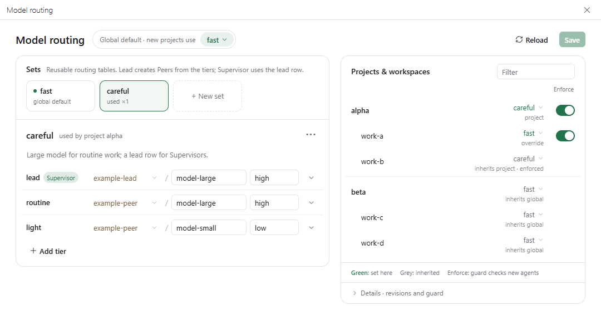

# Model routing for Paseo

A Paseo plugin that keeps a table of provider, model and effort choices per tier
("set"), assigns sets to workspaces and projects, and can refuse agent creations that
were made from an outdated table.



*Demo data.*

## What it does

- **Sets.** `model-routing.md` holds named sets. Each set has one table of tiers (for example
  `routine`), and each row gives a provider, model, effort and note. The `active:` line names the
  global default set.
- **Assignments.** `model-routing-scopes.json` (beside the routing file) assigns a set to a
  workspace or project. A workspace entry wins over its project, and a project wins over the
  global default.
- **Screen.** A "Model routing" screen in the Paseo sidebar edits sets and assignments.
  A save is refused when the file changed since it was loaded.
- **Guard.** In a scope where an assignment has `enforce: true`, a Supervisor creating a Lead,
  or a Lead creating a Peer, must pass the current `routing-rev` label for the role's rows.
  Otherwise the creation is refused with the current rows and the label to add.
- **CLI.** `bin/routing.mjs` prints the effective set for a workspace or project, and edits one
  row with a revision check. It is for source checkouts only (see below).

## Requirements

- Paseo with the plugin API `>=0.14.0` (see `paseo-plugin.json`). Tested on Paseo 0.16.2.
- Node.js with TypeScript type stripping, for the CLI and the tests (tested on Node 26).

## Install

From a clean checkout:

```
npm ci
paseo plugin install /absolute/path/to/model-routing --id model-routing --home <daemon home>
paseo plugin reload model-routing --home <daemon home>
paseo plugin ls --home <daemon home>
```

`plugin ls` should show `model-routing` as `running` and `yes`, with the checkout path as its source.
If the daemon already has a `model-routing` entry, install fails with `Plugin ID "model-routing" is already configured`.
Remove the entry first with `paseo plugin remove model-routing --home <daemon home>`.

Installing a plugin runs its code unsandboxed on the daemon host. Install only code you have read.

Rollback: `paseo plugin remove model-routing --home <daemon home>`. Before any change to a daemon that
already has routing files, copy `model-routing.md` and `model-routing-scopes.json` (if present) to a
timestamped backup, and restore from that backup on rollback. Do not delete the scopes file.

## Files and environment

| Variable | Purpose | Default |
| --- | --- | --- |
| `PASEO_MODEL_ROUTING_FILE` | Routing file (sets and `active:`) | `~/.paseo/model-routing.md` |
| `PASEO_MODEL_ROUTING_SCOPES_FILE` | Assignments file | `model-routing-scopes.json` beside the routing file |

Set the variables in the environment of the daemon that loads the plugin. Other paths are not read.
A missing scopes file means no assignments and nothing enforced.

## Agent CLI (source checkout only)

The CLI reads and writes the same files as the plugin. It is not installed by the plugin and is not
published as a package. Run it from the checkout.

```
node bin/routing.mjs resolve --workspace <workspace-id> [--project <project-id>] [--role lead|peer]
node bin/routing.mjs set-route <set> <tier> --provider P --model M --effort E [--note N] --routing-rev R
```

- Pass `--workspace` or `--project` explicitly. The CLI does not read `PASEO_WORKSPACE_ID` and does not
  look up the daemon, so it never guesses a target from the working directory. Without a target the
  result is `{"error":"unresolved"}` and the exit code is 1. A workspace with no entry also needs
  `--project`, so the project's entry applies.
- `resolve` prints one effective set, its source, whether it is enforced, the role revision, and the routes.
  It never prints other sets or other scopes.
- `set-route` needs the routing-file revision from a previous `resolve` (`revisions.routing`). A stale
  revision is refused and nothing is written.
- The CLI does not check models against the providers the daemon reports. The plugin's screen and save do.

Example, using the example files in `examples/` (run from another directory, with the env variables set):

```
PASEO_MODEL_ROUTING_FILE=/path/to/model-routing/examples/model-routing.md
PASEO_MODEL_ROUTING_SCOPES_FILE=/path/to/model-routing/examples/model-routing-scopes.json
node /path/to/model-routing/bin/routing.mjs resolve --workspace ws-example --project prj-example --role peer
```

Output (formatted for reading; the CLI prints one line):

```
{"set":"fast","source":{"kind":"workspace","id":"ws-example"},"enforced":true,"rev":"e9bbd91d6885","role":"peer",
 "target":{"kind":"workspace","id":"ws-example","via":"flag"},
 "routes":[{"tier":"routine","provider":"example-peer","model":"model-small","effort":"low","note":""},
           {"tier":"review","provider":"","model":"","effort":"","note":"two models of different families"}],
 "revisions":{"routing":"1a3719cd01c2…","scopes":"32b2f0a25c99…"}}
```

A refused edit:

```
node /path/to/model-routing/bin/routing.mjs set-route fast routine --provider example-peer --model model-small --effort low --routing-rev 0000
{"error":"stale","hint":"model-routing.md changed since you read it. Read resolve again and retry with its revisions.routing.","current_routing_rev":"1a3719cd01c2…"}
```

The `rev` from `resolve --role` is the value a creation must carry in its `routing-rev` label.

Not built yet: duplicating or assigning sets from the CLI, unassigning, listing all sets, and reading
the workspace from `PASEO_WORKSPACE_ID`. Use the screen for these.

### Caller and target

A caller's workspace is not the target of a creation. A Lead running in workspace A can create a child
in workspace B. The guard checks the child's actual workspace when the creation happens, and the CLI
targets only the workspace or project you pass. Nothing in either path forces a model: the guard checks
the revision label, and the child's model is whatever the creator requested.

## The guard: behavior and limits

- It checks one thing: that the creator's `routing-rev` label equals the revision of the role's rows
  in the effective set for the child's workspace. It does not check which model was chosen.
- It refuses only fresh, interactive creations with a parent in an enforced scope. Other paths
  (resume, reopen, creations without a parent, unenforced scopes) are allowed.
- It fails open: any internal error or a timeout of 3 seconds lets the creation through.
- The refusal text names the scope, the set, the revision and the rows, and says that nothing was created.
- Reloading the plugin drops plugin tools for a session that is mid-turn, until that session's next prompt.
  Idle sessions keep running; the notes from the isolated test daemon recorded no interrupt.
- It is a freshness check, not a policy: a creator that reads a current table can still choose any model.
- Global enforcement is refused in this version. Enforce per workspace or per project.

## Development

```
npm ci
npm run typecheck
npm test
```

The tests use temporary files and fake daemon data. They do not need a running daemon.

## License

MIT. See `LICENSE`.

The plugin is built against the [Paseo](https://github.com/getpaseo/paseo) plugin SDK
(`@getpaseo/plugin`, Apache-2.0), which is a development dependency only. No SDK code is copied
into this repository; Paseo supplies the SDK at runtime.
